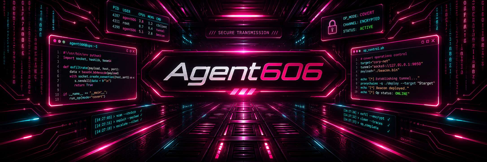

  

<h2 align="center">TRANSMISSION ESTABLISHED</h2>

<em>Stories. Secrets. Messages waiting to be discovered.</em>

  
  

◈ Who is Agent 606?
Welcome to the transmission hub for Agent 606: interactive storytelling, visual novels, game interfaces, and the occasional coded experiment.

The current mission is Secret Messenger, a passion project made by a fan, for fans.
◈ Current mission: Secret Messenger
A familiar messenger. New secrets waiting to unfold.

Secret Messenger is an unofficial, completely free, noncommercial fangame inspired by Mystic Messenger. It's made out of love and appreciation for Cheritz and the world and characters they created.

The project explores new stories and interactive experiences, with a reworked interface and original creative contributions.

No purchases. No paid game content. No donations requested for this project.

  
  
  

Incoming transmissions
Development previews, screenshots, release information, and community links will appear here as they're ready. The public-facing project space is intentionally separate from the game's development source repository.
<!-- Add an approved game screenshot here once uploaded, for example:

-->◈ Behind the signal
Creative development: Visual novels · Interactive narrative · Interface design · Game assets · Ren'Py/Python

Agent 606's style: encrypted transmissions, dark interfaces, neon-magenta accents, and secrets worth uncovering.
◈ Signal links
Community and social channels are being prepared. Official links will be added here once the accounts are recovered and verified.
◈ With love to Cheritz ♡
Mystic Messenger and its original characters and universe belong to Cheritz. Secret Messenger is an unofficial fan creation and is not affiliated with, sponsored by, or endorsed by Cheritz.

Please support the creators and the original game:

  

Additional acknowledgments for the original open-source game foundation and any remaining third-party materials will be included once their exact source links and license requirements have been verified.

AGENT 606 · END OF TRANSMISSION ▌

Secret Messenger is an unofficial fan project. It is not affiliated with, sponsored by, or endorsed by Cheritz.

Please support the original creators and their official games.

**[Play the original Mystic Messenger](https://play.google.com/store/apps/details?id=com.Cheritz.MysticMessenger)**

---

*Agent 606 | Connecting stories, one message at a time.*
